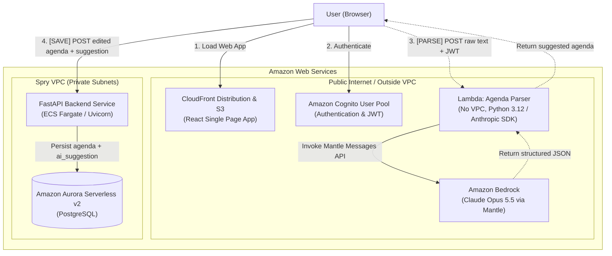

# C4 Container Diagram (Level 2) — Spry Architecture

### Flow Descriptions
1. **Parse Flow (Suggest)**: The user pastes free text in the browser. The browser sends `{ text, today, tz }` with the user's Cognito JWT directly to the Agenda Parser Lambda Function URL (outside the VPC). The parser calls Claude on Amazon Bedrock over the public internet, validates the structured output via the `record_agenda` tool, and returns the suggested agenda JSON to the browser.
2. **Save Flow (Decide)**: The user reviews and edits the pre-filled fields. When the user clicks **Save**, the browser submits the final agenda along with the model's original suggestion (`ai_suggestion`, `model`, `prompt_version`) to the main backend API, which validates and stores it in the Aurora PostgreSQL database. The AI model never writes directly to the database.
